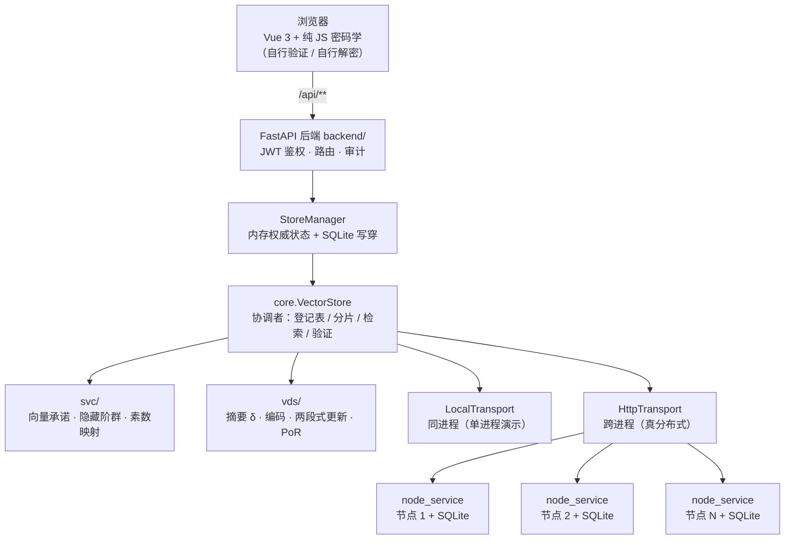

# SVC-system · 可验证分布式存储与可控共享系统

基于**增量聚合向量承诺**（Incrementally Aggregatable Vector Commitments）的可验证分布式存储系统：
文件分块加密后分散存到多台互不信任的存储节点，协调者只保存**常数大小**的承诺与证据；
浏览器端可以独立复算并验证，**服务端无法伪造“验证通过”**。

> 方案来源：ASIACRYPT 2020, *Incrementally Aggregatable Vector Commitments and Applications to
> Verifiable Decentralized Storage*，**§5.2**（SVC 本体）与 **§8.2**（VDS），会议版 §8 = 全文版 §7。
> 本实现采用「**一文件一向量 + 跳文件合并**」的构造：每份文件各有一条向量与一份摘要 δ，
> 跨文件取证时在合并位置集上重算一份证据。

---

## 一、核心能力

| 能力 | 说明 |
|---|---|
| 可验证存储 | 摘要 δ 常数量；证据恒为**至多两个群元素**（模数取 1024 位时上界 256 字节），与文件大小、块数无关 |
| 跨文件查询 | 一次查询可以横跨多个文件、多个用户；在合并位置集上重算一份聚合证据 |
| 增量聚合 / 一步分解 | 证据可任意顺序、任意次数合并（`agg`），也可一步拆出任意子集（`disagg`） |
| 加密存储 | 每块一把独立 SM4 密钥、独立 IV；块密钥用**所有者 SM2 公钥**做 ECIES 封装 |
| 私钥自持 | 私钥用登录口令（PBKDF2-HMAC-SM3，20 万次）封装后入库；服务端不保存明文私钥 |
| 存储证明 | 附录 D.1 的 PoR：不下发内容，确认各节点确实还存着它那份（PDP 不实现） |
| 可审计 | 上传 / 改块 / 追加 / 截断 / 删除 / 解密 / 管理动作全部进审计流水 |
| 故障演练 | 模拟节点「掉线」「永久损毁」，给出「该坏 / 不该坏」的真实影响面，且**绝不删数据** |
| 浏览器自验 | SM2 / SM3 / SM4 / PBKDF2 全部有纯 JS 实现，与 Python 权威输出逐字节对齐 |

两条硬决策：

- **验证不受限**：任何已登录用户都能验证任意文件任意块的完整性（这条路不碰任何密钥）。
- **解密受限**：块密钥用文件**所有者**的 SM2 公钥封装，别人的私钥**算不出来**（管理员也不行）。
  这是密码学强制，而不是应用层一张权限表说了算。

---

## 二、系统架构



**职责边界（关键设计）**

- `svc/`、`vds/` 是**零第三方依赖**的纯标准库算法层，不 import `core`；可以单独安装使用。
- `core/` 是系统层：会话与 CRS、按文件组织的向量存储、节点状态机、传输抽象。
- `backend/` 是服务层：**内存里的 `VectorStore` 才是权威，数据库只是写穿日志**。
  因此后端**必须单进程单 worker**（多进程会各持一份内存状态互相覆盖）。
- `node_service/` 是一台存储节点 = 一个独立进程 = 一个独立 SQLite。
  协调者只告诉节点「发生了什么」（Δ、Υ<sub>Δ</sub>）和「你负责哪些新位置」，
  **新状态由节点自己算出来**（两段式更新 `PushUpdate` / `ApplyUpdate`）。

---

## 三、目录结构

```text
SVC-system/
├─ svc/                 算法内核：向量承诺、隐藏阶群、素数映射、快速打开（零依赖）
├─ vds/                 VDS 应用层：编码、摘要 δ、存储/客户端节点、两段式更新、PoR
├─ core/                系统层：会话与 CRS、VectorStore、节点状态、传输与故障注入
├─ backend/             FastAPI：路由 / 模型 / StoreManager / 配置 / 指标 / 块大小顾问
│  └─ routers/          auth · files · verify · system · admin · perf
├─ node_service/        存储节点独立进程（HTTP + 令牌鉴权 + 自带 SQLite）
├─ frontend/            Vue 3 + Vite + Pinia + Element Plus
│  ├─ src/utils/crypto/ 纯 JS 的 SM2 / SM3 / SM4 / PBKDF2 / 素数 / 验证
│  ├─ src/views/        登录、总览、用户、节点、文件、取证、审计、系统初始化
│  └─ tests/            15 个测试文件 / 162 条用例（node --test）
├─ scripts/             一键启动、建库、验收、基准、静态自检
├─ demo.py              单进程端到端演示（含现场实测性能）
├─ nodes/               部署配置 deploy.json、节点令牌、各节点数据（运行时生成）
├─ 一键启动.cmd / 停止.cmd / 重置并启动.cmd
└─ pyproject.toml / requirements.txt / LICENSE (MIT)
```

---

## 四、快速开始

**环境**：Windows 10/11 · Python ≥ 3.10（实测 3.12）· Node.js（满足 Vite 8）

```powershell
python -m pip install -r requirements.txt
```

首次启动前端时启动器会自动 `npm install`（也可以手动 `npm --prefix frontend install`）。

**启动（推荐双击）**

| 文件 | 作用 |
|---|---|
| `一键启动.cmd` | 起若干台存储节点 + 后端 + 前端，并打开浏览器 |
| `停止.cmd` | 停掉全部进程（只杀本项目的进程，按命令行匹配） |
| `重置并启动.cmd` | 清空 `vds.db` 与全部节点数据、台数/端口复位为默认，再启动 |

**命令行等价形式**

```powershell
python -X utf8 scripts/start_all.py --demo      # 顺带灌 5 个演示文件
python -X utf8 scripts/start_all.py --nodes 6   # 指定台数并写回部署配置
python -X utf8 scripts/start_all.py --stop      # 停止
python -X utf8 scripts/start_all.py --reset     # 清库 + 节点数据后启动
python -X utf8 scripts/start_all.py --no-browser --strict --warm 10000
```

- `--strict`：任何一样退出就整体停下（默认节点掉线只在控制台报警，后端与前端继续跑，便于演示降级）。
- `--warm N`：素数表预热到 N 个（不填按当前用量自动，`0` 跳过）。
- 台数取值范围 **1..32**；默认 **4**。

**入口**

| 入口 | 地址 |
|---|---|
| 前端 | http://127.0.0.1:5173 |
| 后端 API 文档（Swagger） | http://127.0.0.1:8000/docs |
| 健康检查 | http://127.0.0.1:8000/health |
| 存储节点 1..N | http://127.0.0.1:9101 ... |

端口与台数写在 `nodes/deploy.json`，也可以在「管理员工作台 → 存储节点」页面修改（改完需重启生效）。

**演示账号**（口令统一 `vds12345`，由 `scripts/seed.py` 建库时创建）

| 账号 | 角色 | 用途 |
|---|---|---|
| `admin` | 管理员 | 用户管理、存储节点、审计、初始化与系统自检 |
| `system1` | 普通用户 | 上传自己的文件；可验证全部文件，只能解密自己的 |
| `system2` | 普通用户 | 演示「验证不受限、解密受限」 |

> 账号名参与块身份派生素数（`owner` 是身份的一部分），旧库里的账号不能原地改名 ——
> 要换账号请执行一次 `重置并启动.cmd`。

**单进程演示（不需要起服务）**

```powershell
python -X utf8 demo.py
```

它把上传 / 分片 / 单文件查询 / 跨文件跨用户查询 / 更新三路径 / 性能指标 /
三种攻击 / 解密受限 / 存储证明 / 全量自检逐条跑一遍，数字全部现场实测。

---

## 五、配置

后端配置集中在 `backend/config.py`，可用环境变量覆盖：

| 环境变量 | 作用 |
|---|---|
| `VDS_DB_PATH` | 协调者 SQLite 路径（默认项目根下 `vds.db`） |
| `VDS_SECRET_KEY` | JWT 签名密钥。**不设则每次启动随机生成**，重启后所有令牌失效（单进程演示可以接受） |
| `VDS_NODE_IDS` | 节点名单，逗号分隔，如 `node-1,node-2`（不设则按部署配置生成 `node-1..node-N`） |
| `VDS_NODE_URLS` | 节点地址，形如 `node-1=http://127.0.0.1:9101,node-2=http://127.0.0.1:9102`。**不设 = 单进程模式**，设了 = 真分布式模式 |
| `VDS_NODE_TOKEN` | 节点共享令牌（请求头 `X-Node-Token`）。不设则由节点自己生成并写入 `nodes/token.txt` |

前端构建/开发变量：`VDS_API_TARGET`（后端地址，默认 `http://127.0.0.1:8000`）、
`VDS_FRONTEND_PORT`（默认 5173）。

主要参数（`Settings` 默认值）：

| 参数 | 默认 | 说明 |
|---|---|---|
| `modulus_bits` | 1024 | 模数 N 的位长，**演示档无安全强度**；论文配置为 16λ = 2048 |
| `l` | 256 | 每个向量分量的比特数（正好一个 SM3 摘要） |
| `n_max` | 10000 | **素数表容量**（不是块数上限 —— 块数没有天花板） |
| `segment_bytes` | 65536 | 兜底块大小；正常路径按文件大小在阶梯 `1024/4096/16384/65536/262144` 中自动选，使块数 ≤ 128 |
| `replica_factor` | 2 | 每块存几份；**副本不占全局位置**，不改变承诺与证据大小 |

数据与状态：

| 路径 | 内容 |
|---|---|
| `vds.db` (+`-wal`/`-shm`) | 协调者库：用户、公开参数、逐块账目、审计 |
| `nodes/node-N/node.db` | 各节点自己的位置账与密文段 |
| `nodes/deploy.json` | 台数、端口、历史端口 |
| `nodes/token.txt` | 节点共享令牌 |
| `.primecache/` | 素数表磁盘缓存（首次生成后复用） |

> 三条安全红线：`N`、`g` 公开；**`p`、`q`、`φ(N)` 绝不落库**；
> RNG 种子必须随机，日志与 API 响应不带生成过程的中间量。

---

## 六、API 概览

所有业务接口都在 `/api` 下，除登录/注册外都要 `Authorization: Bearer <JWT>`。
错误响应统一带 `code` 字段，前端按码出中文（见 `frontend/src/data/errors.js`）。

### 认证 `/api/auth`

| 方法 | 路径 | 说明 |
|---|---|---|
| POST | `/login` | 登录，返回令牌 |
| POST | `/register` | 注册 |
| POST | `/logout` | 登出（作废当前令牌） |
| GET | `/me` | 当前用户（不含口令哈希与任何私钥材料） |

### 文件 `/api/files`

| 方法 | 路径 | 说明 |
|---|---|---|
| POST | `` | 上传（multipart：`file`、`file_key`、可选 `segment_bytes` / `nodes`），同时用所有者公钥封装每块密钥 |
| GET | `` | **所有**文件列表（验证不受限，不按所有者过滤） |
| GET | `/{file_id}` | 文件详情：每块的下标、持有者、副本、明文长度 |
| PATCH | `/{file_id}` | 改文件（仅所有者），`op` 取 `modify` / `zero` / `append` / `truncate` |
| DELETE | `/{file_id}` | 删除文件（仅所有者；位置段留下空洞、永不回收） |
| POST | `/{file_id}/cipher` | 取密文（不解密）—— 浏览器自解密 + 自验证的入口 |
| POST | `/{file_id}/decrypt` | **解密受限**：只有所有者解得开 |
| POST | `/{file_id}/replay` | 回滚演示：让服务器交回某块的「旧版本」 |
| GET | `/{file_id}/replay` | 当前哪些块正在交回旧版本 |

### 验证与取证 `/api`

| 方法 | 路径 | 说明 |
|---|---|---|
| POST | `/query` | 按**全局下标**查询（可跨文件、跨用户），返回分量 + 聚合证据 + 结论 |
| POST | `/query/files` | 按 `(owner, file_key)` 列表查询（可选块序号），聚合成一份证据 |
| POST | `/query/verify-batch` | 批量验证多份已有证据，并可退回逐份验以定位坏的那份 |
| POST | `/evidence/agg` | 把两份已有证据合并成一份（要求下标集合不相交，不向节点取数据） |
| POST | `/evidence/disagg` | 从一份证据一步拆出子集（要求 K ⊆ I） |
| POST | `/plan` | 块大小顾问：给文件大小，回一种有据可依的切法 |
| GET | `/status` | 系统状态：逐文件摘要、块分布等 |
| GET | `/nodes` | 各节点现状（持有量、跨度、视图是否合法） |
| POST | `/por` | 存储证明（服务端随机挑位置，客户端只决定点几个） |
| GET | `/perf/summary` | 进程内性能环形缓冲的 p50/p95/p99 与吞吐 |

### 管理员 `/api/admin`

用户增删改查、审计流水、`POST /check` 全量自检、`POST /fault-drill` 故障演练、
`GET|PUT /deploy` 台数、`POST /deploy/redistribute` 重新分配、`GET|PUT /ports` 端口。

### 节点服务（内部接口，均需 `X-Node-Token`）

`GET /node/health`、`GET /node/report`、`POST /node/crs`、`POST /node/retrieve`、
`POST /node/pos`、`POST /node/append`、`POST /node/update`、`POST /node/discard`、
`POST /node/drop`、`POST /node/delete`、`POST /node/adopt`、`POST /node/reset`。

**没有一个是「把状态设成这样」** —— 协调者只能告诉节点发生了什么，节点自己算出新状态。

---

## 七、前端页面

| 分组 | 页面 |
|---|---|
| 公开 | 登录 |
| 工作台 | 总览（规模、参数、逐文件摘要、运行性能、处理链路） |
| 文件 | 上传文件、文件详情、更新文件（改块 / 置零 / 追加 / 截断） |
| 取证 | 可验证查询、增量聚合与分解 |
| 个人 | 个人中心、界面偏好 |
| 管理员工作台 | 用户管理、存储节点（含端口与重新分配）、审计流水、初始化与系统自检 |

前端约定：

- **前端不做任何安全判断**，菜单隐藏只是「看不见」，真正权限在 `meta` + 后端。
- 界面文案由前端拥有（`frontend/src/data/copy.js`），后端只回数据。
- 展示给用户的块号**从 1 起算**；代码内部的 `block_idx` 从 0 起算。
- 页面上的「实测数字」是脚本跑完记录的值（`frontend/src/data/measured.js`），不是页面现算的。

---

## 八、验证与测试

### 8.1 前端单元测试

```powershell
npm --prefix frontend test
```

当前 **15 个测试文件 / 162 条用例，全部通过**。覆盖：纯 JS 密码学与 Python 逐字节对齐、
异步 KDF 等价性、本地 TOFU 锚、旧文案还原、输入校验上限、切块阶梯同表、体积估算上界、时间显示等。

### 8.2 离线验收脚本（不需要服务在跑）

```powershell
python -X utf8 scripts/verify_identity_primegen.py   # 身份式素数映射能替代原全流程（双轨对照）
python -X utf8 scripts/verify_session_identity.py    # 会话层两套坐标共存、互不干扰
python -X utf8 scripts/verify_store_identity.py      # 身份坐标下 VectorStore 全部业务流
python -X utf8 scripts/verify_backend_identity.py    # 身份坐标能跨重启存活（落库 / 重建）
python -X utf8 scripts/verify_node_wire.py           # 跨进程线格式不丢字段（进程内 ASGI）
python -X utf8 scripts/verify_fault_drill.py         # 故障演练：该坏的坏了、不该坏的没坏
python -X utf8 scripts/verify_incremental_agg.py     # 增量聚合 / 一步分解在代数上成立
python -X utf8 scripts/verify_segment_ladder.py      # 自动切块阶梯的性质
python -X utf8 scripts/verify_write_rollback.py      # 写失败时节点侧回滚 + 落库原子性
```

### 8.3 静态一致性自检

```powershell
python -X utf8 scripts/check_stage_names.py        # 前端步骤 key ↔ 后端 stage 埋点名
python -X utf8 scripts/check_error_codes.py        # 后端错误码 ↔ 前端 errors.js
python -X utf8 scripts/check_node_report_cache.py  # 节点现状缓存的失效时机
python -X utf8 scripts/check_js_wrap.py            # 「JS 封 → Python 解」互通
```

### 8.4 接口层端到端（需要服务已在 8000 端口运行）

```powershell
python -X utf8 scripts/_e2e_api.py
```

### 8.5 基准与标定

```powershell
python -X utf8 scripts/bench_blocksize.py   # 块大小 → 上传 / 验证耗时曲线
python -X utf8 scripts/bench_batch.py       # 跨文件批量验证到底值不值
python -X utf8 scripts/gen_crypto_vectors.py  # 生成前端对齐向量（crypto-vectors.json）
```

### 8.6 其它工具

| 脚本 | 用途 |
|---|---|
| `scripts/seed.py` | 建库并灌演示账号（`--reset` / `--demo`） |
| `scripts/run_nodes.py` | 单独起 N 台节点（各自独立进程 + SQLite） |
| `scripts/restart.py` | 管理员界面「立刻重启」背后的重启器 |
| `scripts/start_all.py` | 一键启动 / 停止 / 重置 |
| `scripts/_node_forget_stray.py` | 清理节点上协调者不认识的孤儿段（一次没推完的写残留） |

---

## 九、关键设计决定

1. **一文件一向量**：每份文件在全局素数/位置空间里占自己的一段，各有摘要 δ = (U, C, n)。
   新建或改动一份文件**完全不触碰**别人的摘要。
2. **素数按块身份派生**：身份是 `(owner, file_key, block_idx)`，
   `e_i = H(owner‖file_key‖i) → 素数`。于是位置不需要全局分配，**段永不回收**（删文件只留空洞）。
3. **`offset` 只是存储槽位**：它决定密文存在哪，**不参与任何验证**。
4. **证据常数大小**：覆盖 1 块与覆盖上万块，证据都是至多两个群元素。
5. **分量由验证方自己从密文算**：验证方不采信节点声称的分量，而是对收到的密文现算
   `v_i = SM3(c_i)` 再跑承诺验证 —— 「承诺」与「交付的字节」之间没有可声明的自由度。
6. **验证在本地**：本地 TOFU 锚一旦建立，服务端无法替换验证目标。
7. **两段式更新**：`PushUpdate` 产出 Υ<sub>Δ</sub>，`ApplyUpdate` 先校验再应用，后者不需要改动后的内容。

---

## 十、性能与规模

### 10.1 关键实测数字（记录值，`l` = 256 档）

下表是脚本跑完记下的记录值，**与 `frontend/src/data/measured.js` 保持一致**（重新测量时两处要一起改）。
配置：模数 1024 位、`l` = 256（每段密文 1 KB → 摘要 32 字节）、`n_max` = 256、4 台服务器。

| 查询块数 | 凭证数 | 服务器 | 证明生成 | 聚合 | 验证 | 证据字节 |
|---:|---:|---:|---:|---:|---:|---:|
| 1 | 1 | 1 | 12.2 ms | 0.0 ms | 4.0 ms | 256 |
| 2 | 2 | 2 | 24.5 ms | 14.3 ms | 8.4 ms | 256 |
| 4 | 4 | 4 | 42.9 ms | 65.3 ms | 16.9 ms | 256 |
| 8 | 4 | 4 | 27.6 ms | 176.8 ms | 38.2 ms | 256 |
| 14 | 4 | 4 | 0.1 ms | 261.6 ms | 56.6 ms | 129 |

### 10.2 单机一次复跑（`demo.py`）

`demo.py` 在本机（模数 1024 位、`l` = 256、4 台节点、单进程）的一次运行：

| 查询块数 | 凭证数 | 服务器 | 证明生成 | 聚合 | 验证 | 证据字节 |
|---:|---:|---:|---:|---:|---:|---:|
| 1 | 1 | 1 | 3.2 ms | 0.0 ms | 3.0 ms | 256 |
| 2 | 2 | 2 | 6.5 ms | 10.2 ms | 6.0 ms | 256 |
| 4 | 3 | 3 | 3.3 ms | 40.4 ms | 12.3 ms | 256 |
| 5（= 该文件全部块） | 3 | 3 | 0.3 ms | 38.5 ms | 14.7 ms | 129 |

- 证据上界 **2 个群元素 = 2 × 128 = 256 字节**，与查询块数和向量长度都无关。
- 最后一行只剩 129 字节：此刻节点的 `I` 恰好等于挑中的集合，空乘积使 `Λ_I = 1`，
  证据只剩一个群元素 —— 这是方案的定义，不是测量误差。
- 同一行证明生成几乎为零：分解的目标集合就等于节点持有的集合，一个 `add_back` 都不用做。

数字随机器与负载变化。


---

## 十一、已知限制与安全边界

- **演示级参数**：模数 1024 位、分量 256 位，仅供演示；论文配置为 16λ = 2048 位。
- **单进程后端**：权威状态在内存，`uvicorn` 必须单 worker；扩到多进程需要先把向量状态外置。
- **跨文件合并有代价**：要在合并位置集上重算证据，代价与涉及文件的块数相关。
- **重置公开参数会让浏览器本地 TOFU 锚失效**：界面会提示并允许重新见证，不是数据损坏。
- **纯 CTR 不提供完整性**：这是有意的分工 —— 完整性由向量承诺负责；
  块密钥封装的认证标签另外绑定「块身份 + 数据段 IV」，防止换块/换 IV 的替换攻击。
- **SM2 实现未做常数时间防护**：仅用于课程演示；生产应换成经审计的库。
- **单次上传上限 16 MiB**，请求体上限 20 MiB（按 `Content-Length` 提前 413）。
- **不实现 PDP**：它需要另一套累加器结构与知识论证，本方案（§5.2 单累加器）不含这些结构。
- **单机演示形态**：节点进程与协调者同机运行；跨机部署需要自行调整 `deploy.json`、`VDS_NODE_URLS` 与网络。

---

## 十二、许可

[MIT](LICENSE) © 2026 IAVC-VDSS contributors
